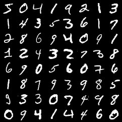
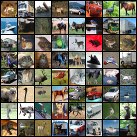

# Assignment 4: Data Preparation, Training, and Reproducibility

**Project:** CIFAR-10 Energy-Based and Diffusion Models with Module 6 GAN Integration

**Repository:** [Ruoxixie402/gentext-app](https://github.com/Ruoxixie402/gentext-app/tree/assignment4-cifar10-ebm-diffusion)

**Submission branch:** `assignment4-cifar10-ebm-diffusion`

## 1. Objective

This assignment implements an energy-based model and a diffusion model trained on
CIFAR-10 and integrates image generation into the existing FastAPI application.
It also includes the Module 6 GAN helper-library activity using MNIST. A shared
data-loading module makes dataset selection, preprocessing, and training inputs
explicit and reproducible.

The implementation separates data preparation, model definitions, training,
sampling, and API inference. Source code, training records, dataset checksums,
input-image previews, and reproduction commands are included in the repository.
The diffusion and energy-model theory responses are provided in the
[Assignment 4 worked answers](assignment4-answers.md).

## 2. Datasets and Preprocessing

| Application | Dataset | Training images | Test images | Image tensor shape |
| --- | --- | ---: | ---: | --- |
| Module 6 GAN activity and Assignment 3 GAN | MNIST | 60,000 | 10,000 | `(B, 1, 28, 28)` |
| Assignment 4 energy and diffusion models | CIFAR-10 | 50,000 | 10,000 | `(B, 3, 32, 32)` |

Here, `B` denotes batch size. MNIST contains grayscale handwritten digits.
CIFAR-10 contains RGB images from ten object categories. Assignment 4 uses
CIFAR-10 for both required models; MNIST is used for the GAN activity.

Images are converted to floating-point tensors with `ToTensor()` and normalized
per channel using mean 0.5 and standard deviation 0.5:

```text
normalized_pixel = (original_pixel / 255 - 0.5) / 0.5
```

This maps pixel values from 0–255 to approximately −1 to 1. Training data are
shuffled, and `drop_last=False` retains the final partial batch. DataLoaders
return both images and original labels. The generative models are unconditional,
so labels are retained for inspection but are not used as training targets.
Training uses `train=True`; held-out CIFAR-10 evaluation uses `train=False`.

## 3. Data-Loader Implementation

The shared implementation is
[helper_lib/dataloader.py](../helper_lib/dataloader.py).
It directly constructs `torchvision.datasets.MNIST`,
`torchvision.datasets.CIFAR10`, their transforms, and PyTorch DataLoaders.

| Function | Purpose |
| --- | --- |
| `get_mnist_dataset(...)` | Construct the real MNIST training or test dataset. |
| `get_mnist_dataloader(...)` | Return normalized MNIST image/label batches. |
| `get_cifar10_dataset(...)` | Construct the real CIFAR-10 training or test dataset. |
| `get_cifar10_dataloader(...)` | Return normalized CIFAR-10 image/label batches. |

These functions are used by the executable training and evaluation programs:

| Program | Data-loading function | Computation |
| --- | --- | --- |
| [examples/module6_mnist.py](../examples/module6_mnist.py) | `get_mnist_dataloader` | Module 6 GAN training and sample display. |
| [app/gan/train.py](../app/gan/train.py) | `get_mnist_dataloader` | Assignment 3 GAN training. |
| [app/cifar10/train.py](../app/cifar10/train.py), `--model ebm` | `get_cifar10_dataloader` | Energy-model training with Langevin negative sampling. |
| [app/cifar10/train.py](../app/cifar10/train.py), `--model diffusion` | `get_cifar10_dataloader` | Diffusion noise-prediction training. |
| [app/cifar10/evaluate.py](../app/cifar10/evaluate.py) | `get_cifar10_dataset(train=False)` | Held-out model diagnostics. |

## 4. Module 6 GAN Integration

The helper library implements the activity's three interfaces:

- [model.py](../helper_lib/model.py): `get_model('GAN')` returns a generator and
  discriminator. The factory also supports FCNN, CNN, EnhancedCNN, and VAE.
- [trainer.py](../helper_lib/trainer.py): `train_gan(...)` performs alternating
  discriminator and generator updates and returns the trained model pair.
- [generator.py](../helper_lib/generator.py): `generate_samples(...)` samples
  latent vectors, generates images, and displays a grid through `plt.show()`.
  It also returns a PIL image for saving.

The complete MNIST example connects these components:

```python
import torch
from torch import nn
from helper_lib import (
    get_model, get_mnist_dataloader, train_gan, generate_samples,
)

loader = get_mnist_dataloader('data', batch_size=128)
generator, discriminator = get_model('GAN')
optimizers = (
    torch.optim.Adam(generator.parameters(), lr=0.0002, betas=(0.5, 0.999)),
    torch.optim.Adam(discriminator.parameters(), lr=0.0002, betas=(0.5, 0.999)),
)
model = train_gan(
    (generator, discriminator), loader, nn.BCELoss(), optimizers, epochs=1,
)
grid = generate_samples(model, 'cpu', num_samples=10)
grid.save('mnist-generated-samples.png')
```

An executed run of the complete example processed **60,000 real MNIST training
images in 469 batches for one epoch**, using batch size 128 and seed 42. Its
[run record](../artifacts/dataset-verification/module6-mnist-run.json) is included.
This is a separate demonstration run; its checkpoint does not replace the
existing API checkpoints.

## 5. Dataset Integrity and Input Samples

[helper_lib/verify_data.py](../helper_lib/verify_data.py) checks dataset types,
split sizes, image dimensions, normalized ranges, and source-file integrity.
It also records class counts and creates grids of the first 64 input images.

For MNIST, available gzip files are checked against torchvision's expected MD5
values. The extracted files' SHA256 hashes are compared with the decompressed
archive contents. Both training archives passed these checks in the recorded run.
If archives are unavailable, the command explicitly reports that only extracted
file hashes were recorded.

CIFAR-10 is downloaded through torchvision from the
[official University of Toronto source](https://www.cs.toronto.edu/~kriz/cifar-10-python.tar.gz).
All five training batch files passed their expected MD5 checks. Their SHA256
hashes are also recorded.

The submitted records are:

- [MNIST dataset report](../artifacts/dataset-verification/mnist-train.json).
- [CIFAR-10 dataset report](../artifacts/dataset-verification/cifar10-train.json).

The following previews contain **real training inputs**, rather than generated
samples. Their labels appear in the corresponding JSON reports in row order,
with eight images per row.

**MNIST training inputs**



**CIFAR-10 training inputs**



CIFAR-10 labels 0–9 correspond to airplane, automobile, bird, cat, deer, dog,
frog, horse, ship, and truck. Raw datasets are stored in `data/` and excluded
from Git; the reports and previews are included in the submission.

## 6. Assignment 4 Training and Evaluation Results

Both models were trained on the complete CIFAR-10 training split using seed 42,
batch size 128, and Adam with learning rate 0.0002.

| Model | Completed epochs in submitted checkpoint | Training record |
| --- | ---: | --- |
| Energy-based CNN | 3 | [EBM training history](../artifacts/assignment4/ebm-training.json) |
| Time-conditioned diffusion UNet | 2 | [Diffusion training history](../artifacts/assignment4/diffusion-training.json) |

On a seeded subset of 512 held-out CIFAR-10 test images:

| Diagnostic | Recorded result |
| --- | ---: |
| Diffusion noise-prediction MSE | 0.0859322 |
| Untrained UNet MSE on the same noisy inputs | 1.0936747 |
| Mean EBM energy for real images | −49.7607 |
| Mean EBM energy for uniform-noise images | 56.1953 |

The [evaluation record](../artifacts/assignment4/validation.json) provides the
settings and interpretation. Noise-prediction accuracy and real-versus-noise
energy separation are learning diagnostics; they do not measure perceptual
sample quality or establish convergence.

## 7. Reproduction Instructions

Use Python 3.12 or 3.13. From a fresh checkout:

```bash
git clone --branch assignment4-cifar10-ebm-diffusion https://github.com/Ruoxixie402/gentext-app.git
cd gentext-app
uv sync --frozen
```

### Load and verify the datasets

```bash
uv run python -m helper_lib.verify_data --dataset all
```

This downloads missing datasets and writes the reports and input-image grids to
`artifacts/dataset-verification/`. To use an existing cache without downloading:

```bash
uv run python -m helper_lib.verify_data --dataset all --no-download
```

If the default MNIST download hosts are unavailable, the optional mirror uses
the same files and expected checksums:

```bash
uv run python -m helper_lib.verify_data --dataset mnist \
  --mnist-mirror https://raw.githubusercontent.com/fgnt/mnist/master/
```

### Run the Module 6 example

```bash
uv run python -m examples.module6_mnist --epochs 1
```

Outputs are saved to `artifacts/module6-example/`: trained generator weights,
a generated sample grid, and `run.json`. Close the plot window to allow the
script to finish. On a headless Linux/macOS shell, use:

```bash
MPLBACKEND=Agg uv run python -m examples.module6_mnist --epochs 1
```

The noninteractive backend permits saving the grid without opening a window.

### Train and evaluate the Assignment 4 models

```bash
uv run python -m app.cifar10.train --model ebm --epochs 3 --channels 16 --threads 1
uv run python -m app.cifar10.train --model diffusion --epochs 2 --channels 16 --threads 1
uv run python -m app.cifar10.evaluate --examples 512
```

These commands write to `artifacts/assignment4/` and replace existing outputs.
The API can also run directly with the submitted checkpoints, without retraining:

```bash
uv run uvicorn app.main:app --host 0.0.0.0 --port 8000
```

The endpoints are `POST /generate/energy` and `POST /generate/diffusion`.
Request examples, Docker commands, and implementation details are provided in
[Assignment 4 usage](assignment4-usage.md).

## 8. Testing and Limitations

The most recent executable test run completed with **35 tests passed**, including
five real-dataset integration checks. These checks cover MNIST and CIFAR-10
training/test splits, image labels, tensor shapes, normalization against raw
pixels, and the optional MNIST mirror cache path.

```bash
uv run python -m pytest tests -q
```

Run dataset verification first to populate a fresh cache. Without cached data,
the dataset integration tests skip rather than download files during pytest.
Other unit tests use small synthetic tensors to isolate neural-network behavior;
those tests are separate from the recorded real-data runs.

The shared loaders preserve the original training splits, transforms, shuffling,
and final partial batches. The dataset reports document the verified input files,
while training histories and the Module 6 run record document their respective
executions. The submitted models are small CPU-trained implementations, and their
generated images remain noisy. Higher-fidelity generation would require further
training and tuning. Product-quality image generation is not inferred from the
successful data checks or API responses.
